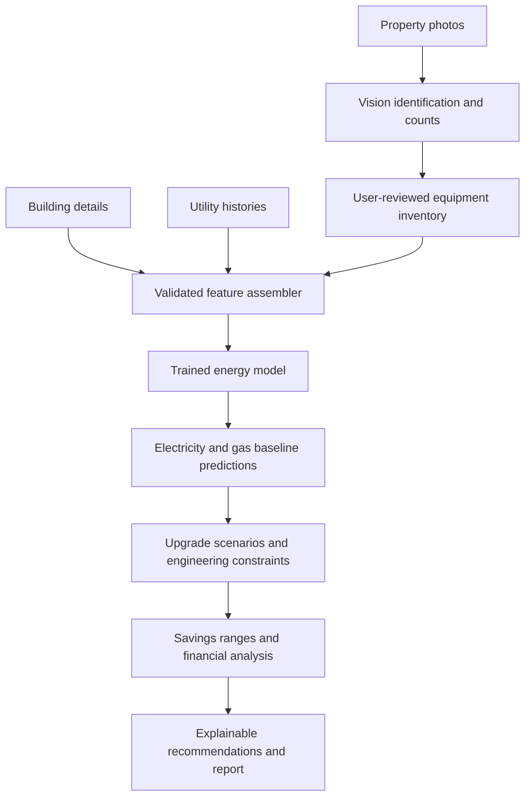

# RetroPilot: AI-Assisted Building Energy Intelligence

**A clearer path to lower energy bills.**

RetroPilot is a building-energy analysis application that combines property photos, building details, utility consumption, a trained AI prediction model, solar-resource estimates, incentive pathways, and explainable financial screening to help building owners identify promising energy upgrades.

## Overview

Energy decisions usually require gathering building details, interpreting bills, inventorying appliances, estimating savings, and researching incentives across different sources. RetroPilot organizes this work into one workflow:

**Photos → Building → Energy → AI Prediction → Recommended Upgrades → Report**

Users can examine projected changes in electricity and natural-gas consumption, potential installation costs, modeled incentives, simple payback, annual ROI, and uncertainty. Results are *preliminary planning estimates*, not contractor quotes, engineering certifications, or incentive guarantees.

## Key Features

- **Property photo intake**: upload JPG, PNG, WebP, or HEIC images from a computer, or capture photos directly on a phone.
- **AI visual inventory**: a vision model identifies and counts visible energy-consuming items (appliances, lights, HVAC equipment), separates electric from gas equipment, and flags uncertainty. Duplicates across overlapping photos are filtered out.
- **Reviewable inventory**: users confirm or correct detected counts before predictions run.
- **Photo-informed AI predictions**: the reviewed inventory feeds the trained energy model alongside building and utility data, so changes to the inventory change the predicted consumption and savings.
- **Building and utility baseline**: address lookup, building type, floor area, age, floors, fuel configuration, and measured usage, with utility bill extraction and manual-entry paths.
- **Upgrade screening**: lighting, HVAC and heat pumps, envelope and weatherization, water heating, rooftop solar, and storage, with compatibility rules so overlapping projects are not double-counted.
- **Solar modeling**: NREL PVWatts v8 production estimates.
- **Incentive exploration**: curated incentive catalog with modeled net costs.
- **Financial analysis**: net cost, simple payback, annual ROI, and lifetime savings, with confidence ranges.
- **Installer recommendations**: for every recommended upgrade, live AI web search finds real installation companies near the property and compares them on job fit and published pricing.
- **AI-generated explanations**: plain-language results grounded in the calculated outputs.
- **Reports**: printable analysis reports and optional saved analyses.

## How RetroPilot Works

### 1. Visual property inspection

Upload photos from a laptop or take them with a phone camera. The system validates and processes the images and uses a vision model to identify *visible* energy-consuming items, estimate counts, distinguish electrical and gas equipment where possible, and report confidence for each item. Overlapping images are de-duplicated so the same appliance is not counted twice.

Vents, windows, and meters are recorded as building context and are not treated as energy-consuming appliances. A photo cannot establish nameplate ratings, actual hours of operation, hidden equipment, or annual utility usage by itself, so these are handled as uncertainty rather than fact. The user reviews and corrects the inventory before it is used.

### 2. Building and utility baseline

Enter the building address, type, floor area, age, floors, fuel configuration, and measured energy usage. Nominatim supports location lookup. Utility usage can be entered manually or extracted from a bill for review. If energy data is missing, RetroPilot uses transparent building-type, size, climate, and vintage assumptions to produce an indicative baseline. A single seasonal bill is not presented as a verified annual measurement.

### 3. AI energy prediction

The reviewed photo inventory, building details, and utility data are assembled into one validated feature set and passed to the trained Keras/TensorFlow model, which predicts electricity and natural-gas baselines.

- The inventory changes the prediction when it is materially relevant (for example, going from 10 to 40 comparable lights changes the lighting load).
- Fuel configuration is respected: an electric-only property never receives an invented gas prediction.
- Image confidence, hidden equipment, and unknown operating hours widen the uncertainty range instead of being asserted as confirmed inventory.
- Predictions are shown with a range, the model version, and the inputs used.

**Model accuracy: 78%.** Accuracy is measured on held-out test buildings that were kept separate from training data.

### 4. Energy upgrade screening

The `lib/analytics` TypeScript engine evaluates suitable measures using the predicted consumption, modeled performance factors, installation costs, solar production, program pathways, and compatibility constraints:

- Lighting efficiency and controls
- HVAC modernization and heat pumps
- Envelope and weatherization improvements
- Domestic water heating
- Rooftop solar and, where relevant, storage

Related projects and alternative heating upgrades are handled so incompatible savings are not simply added together.

### 5. Financial outputs

```text
Net installed cost  = max(0, installed cost - modeled incentives)
Simple payback      = net installed cost / annual savings
Annual ROI (%)      = annual savings / net installed cost * 100
Lifetime net saving = annual savings * assumed lifetime - net installed cost
```

Zero or negative savings and zero net cost are handled explicitly rather than producing invalid ratios. Every estimate shows its inputs, confidence, and assumptions, and distinguishes *measured*, *user-entered*, *estimated*, and *model-predicted* values.

### 6. Installer recommendations

The company feature uses live web search through the OpenAI API, followed by a separate AI comparison step.

1. **Location and upgrade details.** The search uses the city, state, and ZIP already entered, plus the building type, size, and selected upgrade. When available, city and ZIP replace the street address in the search.
2. **AI searches for real installation companies.** It looks for relevant company websites, service-area pages, and contractor directories. It also searches nearby areas when local options are limited.
3. **A second AI call organizes and compares the findings.** It returns structured company names, websites, available phone numbers, services, coverage, reasons for recommending each company, and published pricing.
4. **The server validates the output.** Zod checks the structure. Website and evidence links must match consulted search sources. Unsupported phone numbers and prices are removed, and known directory profiles cannot serve as official company websites.
5. **The dashboard displays the results.** The top upgrade gets a company summary. Selecting another upgrade opens its side panel. Results are cached, and **Find more companies** widens the search while excluding previous results.

**Price comparison limit:** RetroPilot identifies the lowest published starting rate only when multiple companies provide comparable installed prices. Otherwise, it shows "quote required." The suggested first company reflects job fit, not a guaranteed cheapest price. Always get multiple quotes.

### 7. AI extraction and reporting

The OpenAI API supports utility document extraction, visual item recognition, and explanation of results. Zod validates all structured outputs. The financial formulas remain deterministic and auditable; the language model explains results but does not replace the calculations.

## Prediction Pipeline



## Architecture

| Layer | Technology or component | Purpose |
|---|---|---|
| Frontend | Next.js 16, React 19, TypeScript, Tailwind, shadcn/Radix, Recharts | Guided input and analysis views |
| API | Next.js App Router handlers (Node.js runtime) | Validation and service orchestration |
| Structured input validation | Zod | Building, bill, and AI output schemas |
| Image analysis | `lib/property-photos` + OpenAI vision | Appliance recognition and visible-count summary |
| AI prediction | TensorFlow / Keras model | Electricity and gas baseline prediction from photo, building, and utility features |
| Energy and financial screening | `lib/analytics` | Retrofit rankings, savings, and portfolios |
| External services | `lib/services` | Geocoding, solar, utility, and incentive integrations |
| Installer search and comparison | OpenAI web search + structured comparison, Zod validation | Finding, validating, and ranking installation companies per upgrade |
| AI explanations and bill extraction | `lib/ai` | Interpreting user documents and explaining results |
| Persistence | Supabase Postgres or in-memory/browser fallback | Saved analyses when configured |

### Key API routes

| Route | Purpose |
|---|---|
| `POST /api/property-photos/analyze` | Classify and count visible items in uploaded photos |
| `POST /api/utility-bill/extract` | Extract utility document fields for review |
| `POST /api/analyze` | Run the AI prediction, building/utility analysis, and retrofit screening |
| `GET /api/analysis/:id` | Retrieve a saved analysis when available |
| `/api/building`, `/api/incentives`, `/api/calculate` | Supporting lookup and calculations |
| `POST /api/report` | Return report information/print URL |

## Model and Data

- `models/property_energy_model.h5`: the trained Keras energy prediction model.
- `data/test-buildings.csv`: 12 scenarios for testing.


## Run Locally

**Prerequisite:** Node.js 22 or newer.

```bash
npm install
cp .env.example .env.local
npm run dev
```

Open `http://localhost:3000` and use **Explore the demo** or **Analyze**.

### Configuration

| Environment variable | Use |
|---|---|
| `OPENAI_API_KEY` | Server-side vision, bill extraction, and explanations |
| `OPENAI_MODEL` | Text/document model; default `gpt-4.1-mini` |
| `OPENAI_VISION_MODEL` | Optional image-capable model override |
| `PVWATTS_API_KEY` | Optional NREL PVWatts v8 integration |
| `NEXT_PUBLIC_SUPABASE_URL` | Optional Supabase endpoint |
| `NEXT_PUBLIC_SUPABASE_PUBLISHABLE_KEY` | Optional client key |
| `SUPABASE_SERVICE_ROLE_KEY` | Server-only key for optional persistence |

Never commit secret keys or place a server-only credential in a `NEXT_PUBLIC_` variable. Configure `supabase/schema.sql` if using database persistence.

## Validation and Release Checks

```bash
npm test
npm run lint
npm run build
```

## Demo Walkthrough

1. Start with **Explore the demo**, using the fictional Buffalo office example (25,000 sq ft, 145,000 kWh/year, 42,000 therms/year).
2. Review the predicted baseline usage, recommended upgrades, payback, and supporting assumptions.
3. Open **Analyze**, add property photos, inspect the visible-item recognition, and review or correct counts.
4. Enter building and utility data and submit the analysis.
5. Show how the reviewed photo inventory feeds the AI prediction and changes the savings estimates.
6. Walk through the detailed financial comparison and next steps.

---

**RetroPilot**: turning building and energy information into transparent, actionable retrofit decisions.